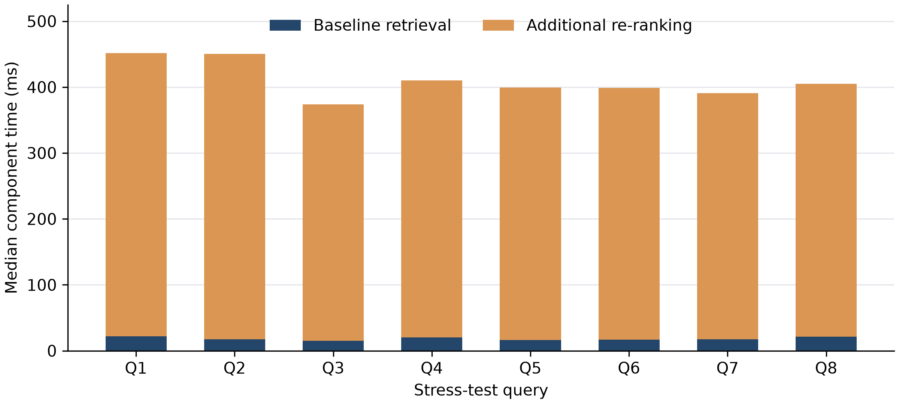

# Chess Rulebook RAG: Baseline vs. Cross-Encoder Re-ranking

This project compares dense retrieval with Cross-Encoder re-ranking for question answering over a US Chess rulebook. Both pipelines retrieve the same ten candidate passages and supply three passages to the same language model. The comparison examines how context selection affects answer completeness and retrieval latency.

## Retrieval pipelines

1. **Baseline:** embed the question, retrieve the Top 10 chunks by cosine similarity, and pass the first three to the language model.
2. **Re-ranking:** score the same ten query-passage pairs with a Cross-Encoder, sort by relevance, and pass the new Top 3 to the same language model.

Both pipelines use the same document, chunks, prompt template, generation settings, and final context size.

## Project files and results

- [Executed notebook](rag_baseline_vs_reranking.ipynb): code, retrieved passages, generated answer comparisons, timings, and validation checks.
- [Report PDF](RAG_Report.pdf): architecture, failure-case analysis, latency, and scaling discussion.
- [Report text](REPORT.md): editable Markdown version of the analysis.
- [Results](results/): exported tables, graphs, and generated answer comparisons.
- [Result exporter](export_results.py): regenerates result files from saved notebook outputs.
- [Git command guide](GIT_GUIDE.md): commands used to upload the project and update it later.
- [Dependencies](requirements.txt): packages needed to run the notebook.

The saved experiment uses `gemma-4-26b-a4b-it` through the Google GenAI client. Q3 promotes its reference chunk from rank 10 to 1; Q6 promotes its reference chunk from rank 4 to 1.

| Case | Baseline evidence rank | Re-ranked position | Observed answer change |
| --- | ---: | ---: | --- |
| Q3: Checkmate and expired clocks | 10 | 1 | Adds the missing both-flags-down condition. |
| Q6: Clock replacement | 4 | 1 | Supplies evidence for replacement exceptions and clock configuration. |

Across eight queries, the mean of the measured query medians was **18.38 ms** for baseline retrieval and **409.94 ms** for retrieval plus re-ranking. Timings exclude model loading, document indexing, and answer generation. These deliberately selected stress tests illustrate retrieval failures rather than estimate accuracy across all chess questions.



## Document corpus

The exact PDF used in the experiment is included as [US_Chess_RuleBook.pdf](US_Chess_RuleBook.pdf), so no separate download is needed after cloning this repository.

This is the 139-page free-download edition, revised 21 August 2020, containing Chapters 1, 2, 10, and 11. Copyright remains with the United States Chess Federation. [Official source](https://new.uschess.org/sites/default/files/media/documents/us-chess-rule-book-online-only-edition-chapters-1-2-10-11-9-1-20.pdf). The experiment answers questions about this document edition.

## Run the notebook

1. Open a terminal in this folder.
2. Optionally create and activate a virtual environment.
3. Install the dependencies:

   ```powershell
   python -m pip install -r requirements.txt
   ```

4. Set a Google GenAI API key for answer generation in the same PowerShell terminal:

   ```powershell
   $env:GEMINI_API_KEY = "your-key"
   ```

5. Start Jupyter, open `rag_baseline_vs_reranking.ipynb`, and run its cells in order:

   ```powershell
   python -m notebook
   ```

The embedding and Cross-Encoder models are downloaded from Hugging Face on their first use. Later runs use the local model cache.

## Export saved results

Save the executed notebook, then run:

```powershell
python export_results.py
```

This reads the notebook's saved outputs without rerunning retrieval or making API calls.

| Output | Contents |
| --- | --- |
| `results/tables/rank_results.csv` | Reference-evidence rankings for all eight queries and initial evaluation timings. |
| `results/tables/rank_shifts.csv` | The two qualifying evidence promotions. |
| `results/tables/latency.csv`, `latency_summary.csv` | Warmed-up component medians and their mean across queries. |
| `results/tables/q1_candidates.csv` through `q8_candidates.csv` | Candidate IDs, scores, ranks, and passage previews. |
| `results/tables/q3_context.csv`, `q6_context.csv` | The actual context chunk IDs for each answer pair. |
| `results/graphs/` | High-resolution latency and rank-change charts, plus the original notebook plot. |
| `results/answer_comparisons.md` | Saved Q3 and Q6 answer pairs. |
| `results/manifest.json` | Source notebook checksum, result-file checksums, and measurement provenance. |

Exports retain the precision stored in notebook display outputs. Candidate previews may be truncated. The latency profiler uses one warm-up and five timed repetitions per query; the two-stage total is the sum of component medians. These profiling results are separate from the initial evaluation timings in `rank_results.csv`.

## What the notebook verifies

- The baseline uses a dense Bi-Encoder and cosine similarity.
- It retrieves exactly 10 chunks and sends its first 3 to the LLM.
- The Cross-Encoder scores exactly those same 10 candidates.
- Re-ranking selects a new Top 3 and uses the identical LLM prompt.
- Chess-specific stress tests cover exceptions, negation, distractors, and constraints.
- Rank shifts and latency are presented as tables.
- Validation checks confirm candidate consistency and the recorded rank 4-10 to Top 3 evidence promotions.

Retrieval rankings can vary with model and library versions. Re-ranking cannot recover a relevant passage missing from the initial Top 10. Improved retrieval also does not guarantee that every generated sentence is faithful to the source; the saved answer comparisons should be read alongside their cited passages.
